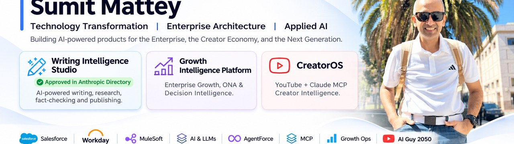

  

# SUMIT MATTEY

### TECHNOLOGY TRANSFORMATION · ENTERPRISE ARCHITECTURE · APPLIED AI

**I turn complex enterprise problems into intelligent products, platforms and measurable business outcomes.**

  
  
  
  

---

## THE BIG PICTURE

I work at the intersection of **business strategy, enterprise technology and AI innovation**. Over 22+ years in technology and consulting, I have led transformation, enterprise architecture, global delivery and Salesforce ecosystem initiatives — translating strategic priorities into platforms that scale.

Today, my focus is on building AI-native systems that move beyond chat and copilots: systems that understand context, reason across business domains, surface evidence and support governed action.

<table width="78%">
<tr>
<td width="33%" align="center">
<strong>22+ YEARS</strong> 
Technology & transformation
</td>
<td width="33%" align="center">
<strong>ENTERPRISE SCALE</strong> 
Architecture & platform leadership
</td>
<td width="33%" align="center">
<strong>BUILDER MINDSET</strong> 
From concept to working product
</td>
</tr>
</table>

## SELECTED WORK

Three products. Three different problem spaces. One consistent design principle: make intelligence useful, explainable and actionable.

<table>
<tr>
<td width="50%" valign="top">

### 01 / WRITING INTELLIGENCE STUDIO

**An approved solution published in the Anthropic directory.**

A Claude-powered editorial workspace that functions like a complete editorial team — from research and structured drafting to challenge, verification, tracked editing and publication readiness.

- Multi-stage editorial workflow
- Evidence-linked citations and fact-checking
- Originality and readability analysis
- Tracked changes with author approval

</td>
<td width="50%" valign="top">

### 02 / GROWTH INTELLIGENCE PLATFORM

**Enterprise Growth & Decision Intelligence for Claude.**

An AI-native platform that turns business-language questions into evidence-backed analysis, decisions and governed next steps across growth, sales, accounts, customers, competition, marketing, finance and operations.

- Cross-domain enterprise intelligence
- Specialist agents and business memory
- Executive decision support and dashboards
- Traceable evidence and approval-aware actions

</td>
</tr>
<tr>
<td colspan="2" valign="top">

### 03 / CREATOROS — YOUTUBE CREATOR INTELLIGENCE

**An MCP-powered intelligence layer for YouTube creators using Claude.**

Connects Claude to a creator's own YouTube channel and turns analytics into practical insight: channel health, video performance, retention, discovery, audience questions and publishing decisions.

- Channel and video diagnostics with fair comparisons
- Audience voice and engagement signals
- Local-first execution, OAuth 2.0 and read-only access
- Historical snapshots to evaluate recommendations

</td>
</tr>
</table>

## WHAT I FOCUS ON

<table>
<tr>
<td width="50%" valign="top">

**ENTERPRISE TRANSFORMATION**

- Enterprise architecture & technology strategy
- Salesforce, Workday, MuleSoft & CPQ
- Platform modernization and integration
- Global operating models and delivery
- Customer outcomes and business growth

</td>
<td width="50%" valign="top">

**AI & INTELLIGENT SYSTEMS**

- Agentic AI and AI-native applications
- Model Context Protocol (MCP)
- Enterprise and decision intelligence
- Knowledge systems, RAG and semantic layers
- Secure integrations, identity and governance

</td>
</tr>
</table>

## TECHNOLOGY TOOLKIT

## BEYOND THE ENTERPRISE

I also run **AI Guy 2050**, where I explore practical AI concepts, emerging technologies and educational content that helps the next generation understand the world being built around them.

## HOW I THINK

> Technology should not simply digitize existing processes. It should fundamentally change what businesses and people can achieve.

**Think strategically. Architect intelligently. Build relentlessly.**

---

**OPEN TO MEANINGFUL CONVERSATIONS**

Enterprise transformation · AI architecture · Agentic systems · Product innovation

[LinkedIn](https://www.linkedin.com/in/sumitmattey/) &nbsp;·&nbsp; [GitHub](https://github.com/matteys001) &nbsp;·&nbsp; [Email](mailto:sumit@matteys.com)

Personal technology portfolio · Built with curiosity and a bias for execution

